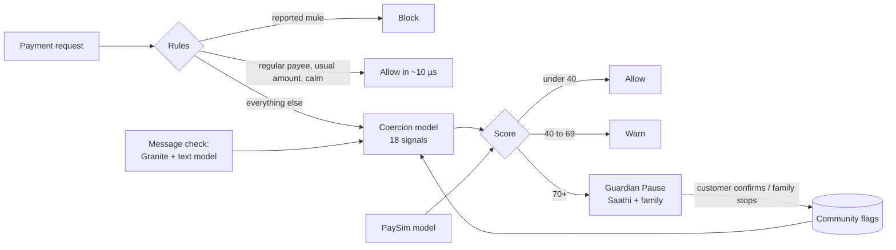

# Guardian Pay

**Catching the moment a customer is being pushed into paying, before the money leaves.**
Built for the IBM Z Datathon 2026, theme: *Real-Time AI for Critical Decisions*.

**Demo video:** https://youtu.be/BxpoHiEtRCo

**Live on IBM LinuxONE (s390x):** https://148-100-99-32.sslip.io (bank console) · https://148-100-99-32.sslip.io/pay (customer app) · https://148-100-99-32.sslip.io/guardian (family contact)

## The problem

In a "digital arrest" scam, someone posing as police, CBI or customs keeps a person on a call for hours and talks them into sending their savings. The victim logs in on their own phone and enters their own OTP and PIN. To today's fraud checks it looks like a normal payment, so it clears in milliseconds. Victims are often retired, and the money is spread across mule accounts within minutes.

Classic fraud detection asks *"is this the real customer?"*. Here the answer is yes. The question that matters is *"is the real customer acting under pressure?"*

## What Guardian Pay does

Every payment is scored inside the transaction, before money moves, with a **coercion score** from 0 to 99.

| Score | What happens |
|---|---|
| under 40 | Paid straight away |
| 40 to 69 | The customer sees a short warning with the reasons and can still pay |
| 70 and above | **Guardian Pause**: a two-minute hold, a short conversation with Saathi, and the family contact is asked to confirm |
| reported account | Blocked |

The pause does not refuse the payment. A genuine emergency goes through as soon as the family contact approves, or by itself when the timer ends. What the pause breaks is the urgency that every scam script depends on.

### The part that makes it different: one customer's answer protects everyone

When a customer tells Saathi that someone on a call is telling them to pay, or their family contact taps **Stop**, the receiving account is flagged across the bank that same second. The next payment to it, from any customer, is paused, even if that person is calm and shows no stress signals at all.

Today that information reaches the bank only when a complaint is filed with 1930, often hours later. By then the same mule account has taken money from many more people. The console marks payments that were caught only because of a flag ("Flag caught it") and shows how much money the flag has kept with customers.

## AI in this project

### Three trained models

| Model | Trained on | What it does |
|---|---|---|
| **Coercion model** (gradient-boosted trees, 18 signals) | 1,000,000 payments from our generator: no public data of coerced payments exists | Scores whether the real customer is paying under pressure |
| **Transaction-pattern model** (gradient-boosted trees) | **PaySim**, 6.36 million public mobile-money transactions (Lopez-Rojas et al.) | Flags payments that look like known fraud patterns |
| **Scam and pressure text model** (logistic regression on word pairs and character pieces) | 12,156 unique messages from four public datasets in English, Hinglish, Hindi and 11 more Indian languages | Reads whole sentences: scam or not, scam type, urgency, blackmail |

### Generative AI: IBM Granite

- **Saathi, a voice companion on the pause screen.** A calm assistant talks with the customer in Hindi (or Hinglish, or English, matching how they write). The customer can speak instead of type: the phone's own speech recognition listens in Hindi, and replies are read aloud. Saathi asks one gentle question at a time. If the customer mentions police, CBI, arrest, a parcel or a video call, Saathi says plainly that real officers never do this, and suggests cutting the call and calling 1930.
- **Message checker.** The customer pastes the WhatsApp or SMS that came with the account number, or adds a screenshot. Granite, the text model and the safety net read it together and name the scam pattern with red flags and advice in Hindi and English. If it is a scam and the customer still pays that account, the payment is paused with that reason.
- **Case notes for the fraud desk.** Every paused payment gets a short note from Granite with the likely scam type and the next step.

Granite runs in two places. On **watsonx.ai** (Granite 4, about 2–3 s per reply), and **inside LinuxONE** itself: IBM's LinuxONE AI image ships Granite 3.3 2B on llama.cpp built with zDNN, so the model uses the Telum chip's on-chip accelerator and no data leaves the machine. With watsonx keys in `.env`, watsonx answers first and the on-machine Granite is the backup; `GUARDIAN_PREFER_LOCAL=1` reverses that.

### Built so that AI can't make it worse

- **AI informs, people decide.** No model output on its own sends or stops money. Saathi can recommend cancelling; the customer or the family contact decides.
- **Three layers read every sentence:** Granite for meaning, the trained text model for patterns it learned from real messages, and a keyword safety net (English, Hinglish, Devanagari, negation-aware, so "koi call pe nahi hai" is not read as a call). Granite can raise the risk but never lower it below what the other two say.
- **Prompt injection.** Customer text goes in as evidence and the prompts tell the model to ignore instructions inside it. The two other layers are the backstop.
- **Strict output.** Every Granite answer must be one JSON object with known fields (grammar-constrained on llama.cpp). A bad answer gets one repair attempt, then the app falls back.
- **Fallbacks at every step.** watsonx down: on-machine Granite. Both down: Saathi runs a scripted conversation, the checker uses the text model and rules, and case notes are written from the engine's signals.

## Results

All numbers are on held-out data the model did not see in training.

**Coercion model** (800,000 train / 200,000 test synthetic payments, 5.3% scams)

| | |
|---|---|
| ROC AUC | 0.970 |
| Scams paused at score 70+ | 82.7% (digital arrest: 98.5%) |
| Precision at 70+ | 98.1% |
| Genuine payments wrongly paused | 0.09% |
| Real family emergencies paused | 0.6% |
| Decision time | median 14 µs, p99 1.4 ms per payment on one core |

**PaySim model** (2.77 million TRANSFER and CASH_OUT rows; trained on steps 1–332, tested on later steps 333–743)

| | |
|---|---|
| ROC AUC | 0.9996 |
| Average precision | 0.953 |
| At score 80+ | precision 98.7%, recall 67.4% |

**Text model** (80/20 split of 12,156 unique messages)

| | |
|---|---|
| ROC AUC | 0.9996, F1 0.993 |
| Trained on three datasets, tested on the fourth | AUC 0.99 (Hinglish calls), 0.98 (Hinglish texts), 0.92 (UCI SMS), 0.70 (14 Indian languages) |

The last row is the honest one: the model is very good on the kind of message it has seen and weaker on a new style or language it has not, which is why Granite and the safety net sit beside it.

## How a decision is made



**Signals**, all of which a bank already has or its app can capture:

- *How the person is paying, captured live by the app:* leaving the app mid-payment (to take instructions on WhatsApp or a call), pasting an account number, time frozen on the confirm screen, changing the amount, retrying after a limit, session length.
- *What the bank knows about the sender:* amount against their usual payment, share of balance, first payment to this payee, fixed deposit broken in the last 24 hours, time of day, age.
- *What the receiving account has been doing:* account age, credits and distinct senders in the last 24 hours, share of those senders aged 60+, share of money already moved onwards.

Every pause comes with its reasons in English and Hinglish. A reason's weight is how far the score falls when that one signal is set back to a calm value.

## IBM Z and LinuxONE

Payments already run on IBM Z, so this is the place to score them: inside the transaction, with no round trip to another system.

- The app, all three models and the Jupyter notebook run on **LinuxONE (s390x)** in the IBM LinuxONE Community Cloud, inside IBM's own LinuxONE AI image.
- `notebooks/Guardian_Pay_on_LinuxONE.ipynb` trains all three models on LinuxONE, scores 20,000 payments one by one to measure decision time, and runs Granite inside LinuxONE through llama.cpp with zDNN.
- The trained models are exported as plain decision trees and weights in JSON and scored in plain Python, so scoring needs no compiled ML library.
- In production, the same models would be served by IBM Machine Learning for z/OS, which runs inference on the Telum on-chip AI accelerator inside the business transaction.

## Run it

**On LinuxONE Community Cloud** (Ubuntu 24.04-Datathon image):

```bash
# on your computer
scp -i datathon.pem guardian-pay.zip linux1@<server-ip>:~
ssh -i datathon.pem linux1@<server-ip>

# on the server
mkdir -p ~/shared && cd ~/shared && sudo apt-get install -y unzip && unzip -o ~/guardian-pay.zip
nano guardian-pay/.env          # optional: watsonx values, see .env.example
bash guardian-pay/deploy/linuxone_docker.sh
```

The script installs Docker, pulls IBM's LinuxONE AI image, opens the ports, starts Jupyter Lab on port 38888 and the app on port 8000, and sets up free https so the phone microphone works. It prints the links when it is done. The console's top bar shows the machine architecture, so `s390x` there proves where it runs.

**Locally** (Python 3.10+): `pip install -r requirements.txt && uvicorn guardian.server:app --port 8000`, then open `/`, `/pay` and `/guardian`.

Settings in `.env` or the environment: watsonx keys (`.env.example`), `GUARDIAN_PREFER_LOCAL=1`, `GUARDIAN_COOLING_SECONDS` (default 120), `GUARDIAN_SIM_INTERVAL` (default 1.2), `GUARDIAN_SIM=0` to turn simulated traffic off.

## Three-minute demo

1. Open the console on the projector. Simulated customers are paying; nearly every bar on the strip is green.
2. On a phone, open `/pay` and pay **Gupta General Store ₹1,800**. It goes through instantly.
3. Tap **Check a suspicious message**, paste a fake "CBI officer" WhatsApp. The checker calls it a digital-arrest scam.
4. Tap **Pay a new account**, paste the demo account (R K Enterprises, `5010 0447 1229 06`), switch to another app and back once or twice, enter **₹6,50,000** and accept the offer to break the FD.
5. **Guardian Pause** appears. Tap the mic and tell Saathi in Hindi: "ek officer video call pe hai". Saathi warns you. On a second phone, `/guardian` lights up for the daughter with the conversation.
6. Cancel. The console shows R K Enterprises flagged. Watch the next simulated payments to it get paused with **Flag caught it**, and the AI case note on the paused payment.

## Data sources

- **PaySim**: E. A. Lopez-Rojas, A. Elmir, S. Axelsson, "PaySim: A financial mobile money simulator for fraud detection", EMSS 2016. Kaggle `ealaxi/paysim1`; the same file is mirrored at `huggingface.co/datasets/theman10/paysim` (MIT). Download it with the notebook; it is not in the repo.
- **UCI SMS Spam Collection** (Almeida and Hidalgo, CC BY 4.0), in `data/text/`.
- **Indian Cyber Scam Phone Call Hinglish Dataset**, `Nithingayakwad/Indian_Cyber_Scam_PhoneCall_Hinglish_Dataset` (Apache-2.0).
- **Scam/ham SMS in 14 Indian languages**, `anmolshrivastav/scam_ham_india_14_languages` (MIT).
- **Hinglish and English scam texts**, `Yash1072006/hinglish-scam-text-dataset` (CC BY 4.0).

`python -m guardian.fetch_data` downloads the three Hugging Face text sets again.

## Project layout

```
guardian/
  engine.py         rules + coercion model + explanations, pure Python
  generator.py      payment generator for the coercion model (1M rows in ~2 s)
  train.py          trains the coercion model, exports it as JSON trees
  train_paysim.py   transaction-pattern model on PaySim
  text_model.py     scam and pressure text model (training and pure-Python inference)
  llm.py            Granite: watsonx.ai client and on-machine llama.cpp
  ai_features.py    Saathi, message checker, case notes, safety net
  bank.py           in-memory demo bank: customer, receivers, flags
  simulator.py      background traffic for the console
  server.py         FastAPI: API, live event stream, pages
model/              trained models (JSON)
notebooks/          Guardian_Pay_on_LinuxONE.ipynb
deploy/             LinuxONE setup scripts
web/                console, customer app, family screen (no build step)
tests/              36 tests
```

Tests: `pip install pytest httpx && python -m pytest -q`. The AI tests use a local stand-in for watsonx that checks every request has the shape the real API expects, and a stand-in for llama.cpp.

## Honest limits

- **The coercion model learns from generated data.** No bank shares labelled data of coerced payments. The generator includes hard cases (an anxious 70-year-old paying her daughter, a real family emergency, scams whose receiving account still looks clean), but real deployment would retrain on a bank's own cases.
- **Public scam-text datasets are partly templated**, which is why we report the cross-dataset results above and keep Granite and the safety net beside the text model.
- **Call detection.** A web page cannot see whether the phone is on a call, so the demo uses app switching as the stand-in. A bank's own app can read call state on Android.
- **No real money moves.** The bank in this demo is an in-memory mock.

## Built with

IBM LinuxONE Community Cloud, IBM's LinuxONE AI image, IBM Granite (watsonx.ai and llama.cpp with zDNN), Python, scikit-learn, FastAPI, server-sent events, the browser's Web Speech API, plain HTML, CSS and JavaScript, IBM Plex.
